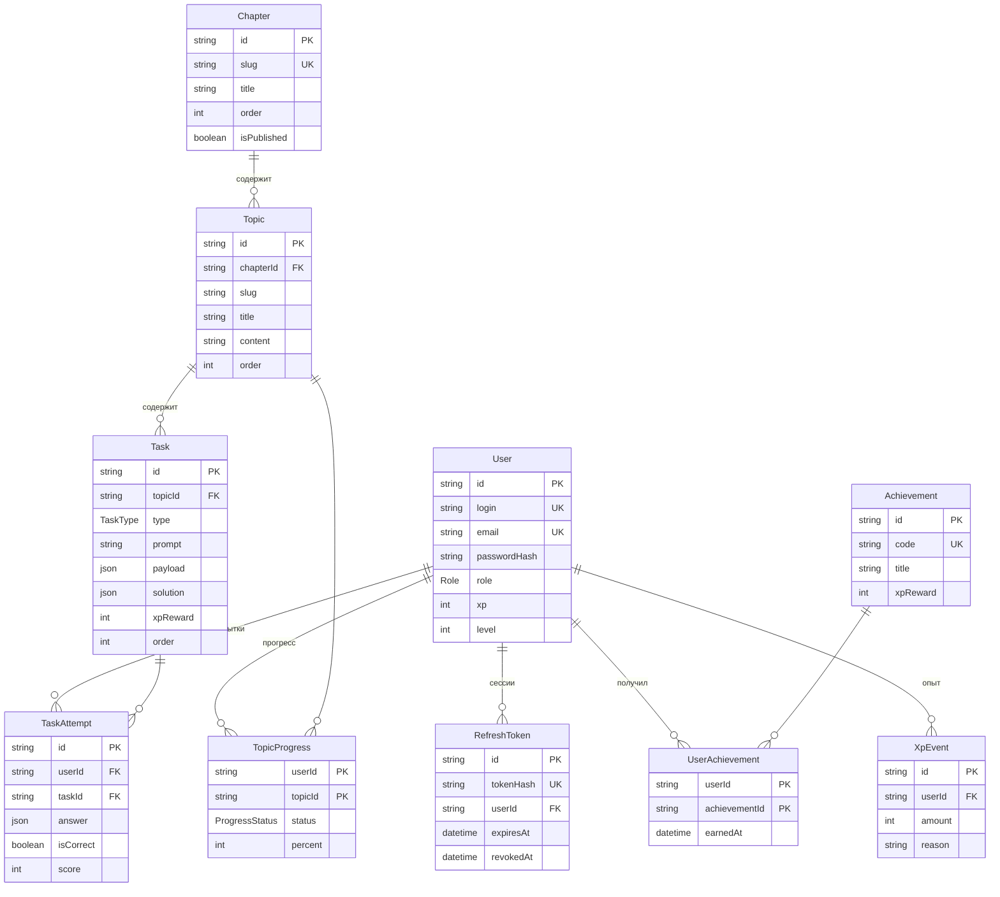

# База данных

PostgreSQL, схема — `prisma/schema.prisma`. Диаграмма ниже отрисовывается прямо на GitHub.

## ER-диаграмма

## Таблицы

| Таблица | Назначение | Важное |
|---|---|---|
| User | ученики и администраторы | `login` и `email` уникальны; `xp`, `level` — денормализованная сумма для быстрых выборок |
| RefreshToken | активные сессии | хранится только хеш токена; `revokedAt` для отзыва и ротации |
| Chapter | глава курса | `order` задаёт порядок, `isPublished` скрывает черновики |
| Topic | тема внутри главы | `slug` уникален в пределах главы; `content` — Markdown |
| Task | задание темы | `type`: QUIZ, CODE, TEXT; `payload` — данные для клиента; `solution` — только для сервера |
| TaskAttempt | каждая попытка ответа | история не удаляется: из неё считается статистика |
| TopicProgress | прогресс по теме | составной ключ `(userId, topicId)` |
| Achievement | справочник достижений | `code` — стабильный идентификатор для кода |
| UserAchievement | выданные достижения | составной ключ: одно достижение выдаётся один раз |
| XpEvent | журнал начислений опыта | источник правды для `User.xp` |

## Правила

- Удаление пользователя каскадно удаляет его сессии, попытки, прогресс и опыт.
- Удаление главы удаляет её темы и задания. Для опубликованного контента используйте `isPublished = false` вместо удаления.
- Начисление опыта: запись в `XpEvent` и обновление `User.xp` — в одной транзакции.
- Миграции создаются командой `npm run db:migrate -- --name <что_изменили>` и коммитятся в `prisma/migrations`.
